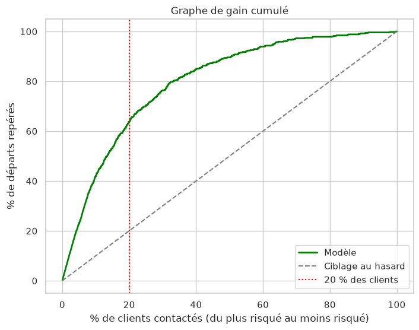
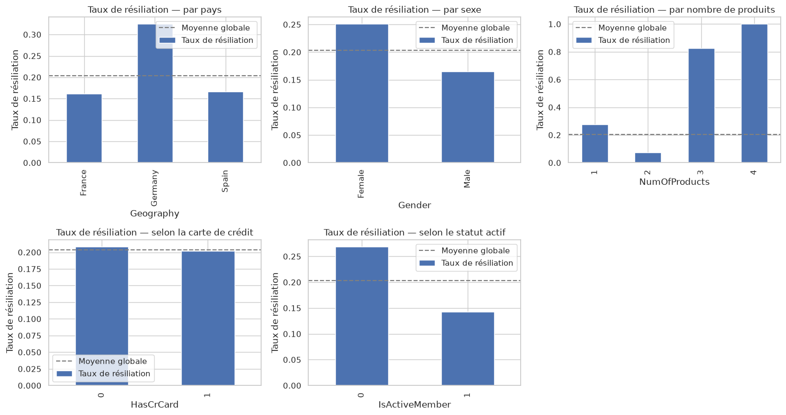
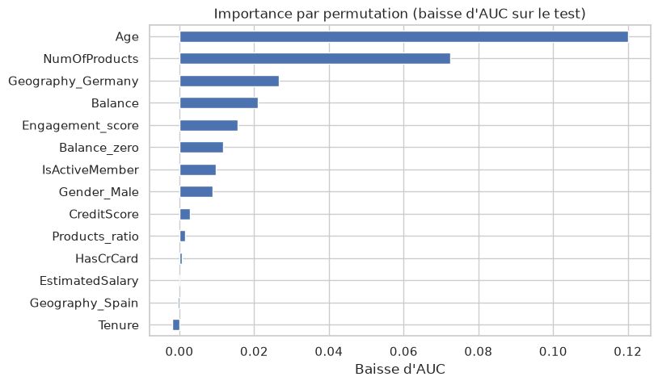

# Scoring de résiliation client (*churn*) dans une banque

Prédire quels clients vont quitter la banque, pour concentrer les actions de fidélisation là où elles comptent.
Projet de Machine Learning en Python avec scikit-learn.

**Résultats clés**

- Meilleur modèle : **HistGradientBoosting**, **AUC de 0,874** sur le jeu de test.
- En contactant les **20 %** de clients les plus à risque, la banque repère **64 %** des départs, plus de 3 fois mieux qu'un ciblage au hasard.
- Probabilités **bien calibrées** : le taux de départ prédit correspond au taux observé, segment par segment.

👉 Le détail de l'analyse, avec le code et les graphiques, est dans le notebook [`churn_scoring.ipynb`](churn_scoring.ipynb).

## Le problème

Dans une banque, garder un client coûte beaucoup moins cher que d'en conquérir un nouveau. L'objectif est de
construire un **score de résiliation** : pour chaque client, la probabilité qu'il parte. La banque peut ensuite classer
ses clients du plus risqué au moins risqué et cibler ses campagnes de rétention.

## Les données

Jeu de données public *Churn Modelling*, disponible sur [Kaggle](https://www.kaggle.com/search?q=Churn+Modelling) :
**10 000 clients** d'une banque présente en France, en Allemagne et en Espagne, décrits par 10 variables (âge,
ancienneté, solde, nombre de produits, pays, activité…). La cible `Exited` vaut 1 si le client est parti : c'est le cas
de **20,4 %** des clients, les classes sont donc déséquilibrées.

## Démarche

1. **Exploration et préparation** : distributions, taux de départ par groupe, création de trois variables
   (`Balance_zero`, `Products_ratio`, `Engagement_score`), encodage, standardisation sans fuite d'information.
2. **Régression logistique pénalisée** : Ridge et Lasso, paramètre choisi par validation croisée.
3. **Méthodes locales** : K plus proches voisins, arbre de décision (profondeur choisie par validation croisée, élagage).
4. **Méthodes d'ensemble** : forêt aléatoire (erreur OOB, optimisation des hyperparamètres), HistGradientBoosting avec arrêt précoce.
5. **Compromis biais-variance** : courbes d'apprentissage et simulation avec seulement 500 clients.
6. **Recommandations métier** : calibration, graphe de gain, profil des clients les plus à risque, transposition à l'assurance.

## Résultats

| Modèle | AUC | F1-score | Précision | Rappel |
|---|---|---|---|---|
| **HistGradientBoosting** | **0,874** | **0,604** | 0,775 | 0,495 |
| Forêt aléatoire (optimisée) | 0,869 | 0,594 | 0,820 | 0,466 |
| Arbre de décision (profondeur 5) | 0,849 | 0,553 | 0,799 | 0,422 |
| Régression Lasso | 0,847 | 0,495 | 0,729 | 0,375 |

Précision et rappel sont calculés avec le seuil par défaut de 0,5. Pour une campagne de rétention, on utilise plutôt le
**classement** des clients par score :



| Segment de risque (20 % des clients chacun) | Départs prédits | Départs observés |
|---|---|---|
| 1 - Très faible | 2,4 % | 2,2 % |
| 2 - Faible | 5,5 % | 4,0 % |
| 3 - Moyen | 10,0 % | 9,2 % |
| 4 - Fort | 21,8 % | 21,4 % |
| 5 - Très fort | 62,6 % | 65,0 % |

## Ce que révèlent les données

- **L'âge** est le premier facteur : 44,8 ans en moyenne chez les clients partis, contre 37,4 ans chez les fidèles.
- **Le nombre de produits** a un effet en U : 7,6 % de départs avec 2 produits, mais 27,7 % avec 1 seul et plus de 80 % avec 3 ou 4.
- **L'Allemagne** compte deux fois plus de départs que la France et l'Espagne (32,4 % contre environ 16 %).
- **Les clients inactifs** partent presque deux fois plus que les actifs (26,9 % contre 14,3 %).
- Une hypothèse intuitive démentie : les clients au **solde nul** partent *moins* que les autres (13,8 % contre 24,1 %).



## Ce que ce projet m'a appris

- **Vérifier ses interprétations.** Les plus gros coefficients de la régression venaient en partie de la
  **colinéarité** entre mes variables : en isolant l'indicateur « au moins 2 produits », les coefficients redeviennent
  lisibles, pour la même AUC.
- **Choisir la bonne mesure d'importance.** L'importance par impureté de la forêt plaçait le salaire et le score de
  crédit en tête ; l'**importance par permutation**, mesurée sur le test, montre qu'ils n'apportent presque rien et que
  la forêt et le Lasso sont en fait d'accord.

  

- **La complexité doit se justifier.** Avec 500 clients seulement, une régression Ridge fait presque jeu égal avec la
  forêt aléatoire (0,820 contre 0,828) : quand les données sont rares, un modèle simple suffit.
- **Éviter les fuites d'information.** La standardisation est ajustée sur le jeu d'entraînement seulement ; pour un
  cas d'assurance, le découpage devrait être temporel (entraînement sur l'année N−1, test sur l'année N).

## Lancer le projet

```bash
git clone https://github.com/iammonika10/churn-scoring.git
cd churn-scoring
python -m venv .venv
# Windows : .venv\Scripts\activate    |    macOS / Linux : source .venv/bin/activate
pip install -r requirements.txt
```

Téléchargez ensuite le fichier `Churn_Modelling.csv` depuis Kaggle, placez-le dans le dossier `data/`, puis lancez :

```bash
jupyter notebook churn_scoring.ipynb
```

Les versions des bibliothèques sont figées dans `requirements.txt` : avec ces versions, on retrouve exactement les
résultats ci-dessus. L'exécution complète prend quelques minutes.

## Structure du dépôt

```
churn-scoring/
├── churn_scoring.ipynb   # analyse complète, exécutée avec ses graphiques
├── requirements.txt      # bibliothèques et versions
├── data/                 # emplacement du fichier Churn_Modelling.csv (non versionné)
└── images/               # graphiques utilisés dans ce README
```

## Auteure

**Rhina Monika LACMOU DZUFO**, étudiante en Master of Science Big Data & Intelligence Artificielle à l'ESTIA.
[LinkedIn](https://www.linkedin.com/in/rhina-lacmou-dzufo)
